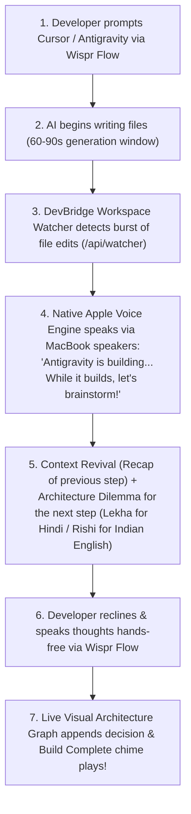

> **⚠️ SUPERSEDED — 25 Oct 2026.** This document is kept for history only. It is no longer the source of truth.
> See [`PRD.md`](./PRD.md) for what gets built and [`SDLC.md`](./SDLC.md) for how it gets built.
> Two claims here were retired: (1) the product briefs the **next** step during a build — it now briefs the **last** step;
> (2) "genuine tool calling" was never implemented — the API returned hardcoded strings.

# DevBridge (VoiceAnchor): Original Plan vs. Evolved Architecture Blueprint

> **Hackathon Pitch:** *"Killed 40-Min Build-Time Phone Traps via Spoken Architecture Brainstorming & Native IDE Integration"*  
> **Challenge:** [No Hands: The Wispr Challenge](https://www.wemakedevs.org/wispr) by WeMakeDevs × Wispr Flow  
> **Track:** Track 1 (Builders)

---

## 1. Context & The Core Problem

### The Daily Reality of AI Developers
1. **The 60–90s AI Build Void (The Phone Trap):**
   When prompting AI coding tools (**Antigravity, Cursor, Codex**), the AI takes 60–120 seconds to plan, write multi-file code, or compile. During this idle wait, developers instinctively grab their phone (Instagram Reels, Snapchat, YouTube). A 90-second wait turns into a 40-minute doomscrolling black hole.
2. **The "Zero-Knowledge Vibe Coder" Dilemma:**
   Early and intermediate developers have AI generate complete codebases without understanding the underlying workflow or data flow. When bugs appear or interview questions arise, they are completely helpless.

---

## 2. Pehle Ka Pura Plan (The Original Plan)

### How It Was Conceived:
- **Core Mechanism:** Client-Side Webcam Computer Vision Watchdog (TensorFlow.js + COCO-SSD) running in the browser.
- **The Flow:**
  - Webcam watched the desk and developer's hands continuously.
  - If a `cell phone` object was detected in frame, screen flashed a full-screen red warning modal and sounded an alarm.
  - To dismiss, developer had to verbally justify using Wispr Flow.

### Why It Failed in Real-World Testing (The Friction Points):
1. **Awkward & Invasive ("The Surveillance Trap"):**
   Having the green MacBook camera LED constantly turned on feels creepy, awkward, and uncomfortable during normal daily coding.
2. **High Battery Drain & Machine Heat:**
   Running real-time neural network tensor inferences in the browser at 30 FPS drained laptop battery and triggered CPU/GPU fans.
3. **Computer Vision False Positives:**
   Room lighting, shadows, coffee mugs, holding a pen, or holding an apple/remote caused false alarms.
4. **Wrong Psychology ("Police Officer vs. Engineering Partner"):**
   The camera made the tool feel like a punitive boss watching over your shoulder, rather than an intelligent senior engineer collaborating with you.

---

## 3. Abhi Ka Change Idea (The Evolved, 100% Workflow-Driven Plan)

### The Strategic Shift:
**Completely remove the camera.** Shift the trigger from intrusive physical monitoring to **100% Software & IDE Workflow Integration!**

### How The Evolved System Works:

### The New Superpowers:
1. **IDE Build-Wait Interceptor (Chokidar + SSE):**
   Directly watches your project directory. It knows the *exact second* Cursor or Antigravity starts writing code, and intercepts the dead-time automatically.
2. **Native Apple Indian Neural Voices (`/api/speak`):**
   Zero robotic American accents!
   - **Lekha (`hi_IN`):** Crystal-clear, natural, authentic Hindi (*"पिछले स्टेप में लॉगिन रूट बना था, अब आगे सोचो..."*).
   - **Rishi (`en_IN`):** Fluent Indian English for professional developer discussions.
3. **Active Spoken Dialogue Psychology:**
   Reading text or waiting silently is passive (leading to phone grabs). But when an AI speaks out loud to you and asks an architectural question, your brain is forced into **active vocal engagement**. You cannot scroll Instagram reels while speaking aloud!
4. **Gentle Inactivity Nudge (No Camera Needed):**
   If the developer goes completely inactive for >45 seconds during an active sprint, DevBridge gently prompts: *"Still with me? We were in the middle of: Setup Redis container. Did step 1 finish?"*
5. **Voice Multi-Task Manager with Context Memory:**
   Queue and switch tasks purely by voice (*"Ek task add karo: Logout route pe Redis blacklist"*). When switching back, DevBridge remembers all previous files and decisions.

---

## 4. Side-by-Side Comparison Matrix

| Evaluation Dimension | Pehle Ka Plan (Camera-Based) | Abhi Ka Change Idea (Workflow-Driven) | Why Evolved Version Wins |
| :--- | :--- | :--- | :--- |
| **Primary Trigger** | Webcam detecting phone in hand | Real file edits from Cursor/Antigravity | 100% tied to actual coding work, zero false alarms. |
| **Privacy & Comfort** | Green camera LED on, feels surveilled | Zero camera, 100% private | Developer can code comfortably for 8 hours without feeling watched. |
| **Battery & Performance** | Heavy GPU/TensorFlow tensor loads | Lightweight SSE + File Watcher | Negligible CPU (<0.5%), zero battery drain. |
| **Voice Accent** | Broken robotic browser voice | Native Apple Lekha (Hindi) & Rishi (Indian English) | Sounds like a natural human Indian engineer sitting next to you. |
| **Tool Relationship** | Punitive "Police Officer" | Collaborative "Senior Staff Engineer Partner" | Empowers and teaches the developer instead of punishing them. |
| **Wispr Flow Role** | Emergency vocal excuse pass | Core conversational brainstorming engine | Deeply meaningful, driving architecture decisions and task queueing. |
| **Beginner Value** | Just blocks phone | Explains code workflow in simple Hindi | Solves the "Zero-Knowledge Vibe Coder" problem completely. |
| **Pro Developer Value** | Annoying false alarms | Debates scale, race conditions, edge cases | Makes the codebase 10x more resilient and creative. |

---

## 5. Complete 8-Feature Inventory of the Evolved System

### 1️⃣ Universal IDE Workspace Connector (`/api/watcher`)
Tracks live file writes by Cursor, Antigravity, and Codex using Node.js `chokidar` and streams events via Server-Sent Events (SSE).

### 2️⃣ Build-Wait Interceptor
Automatically detects when AI is generating code (>60s) and triggers the collaborative voice session during the exact window when developers drop into distraction.

### 3️⃣ Native Apple Indian Voice Engine (`/api/speak`)
Integrates directly with macOS speech APIs using Apple's neural voices:
- **Lekha:** Pure Hindi in Devanagari.
- **Rishi:** Indian English developer accent.

### 4️⃣ Adaptive Developer Profiler (`/api/brainstorm`)
- **Pro Architect Mode:** Focuses on scale, latency, Redis TTL, race conditions, and distributed systems.
- **Beginner Mentor Mode:** Explains digital gate-pass concepts in accessible Hindi without intimidating jargon.

### 5️⃣ Spoken Context Revival & Next-Step Dilemma
Recaps the previous commit/route and challenges the developer with an open-ended design dilemma.

### 6️⃣ Hands-Free Wispr Dialogue Hub
Glowing auto-focused Wispr voice input bar with live audio feedback. Auto-submits spoken thoughts to the AI.

### 7️⃣ Live Dynamic Visual Architecture Graph
Interactive node pipeline (`Step 1 Done ➔ Step 2 Generating ➔ Step 3 Wispr Decision`) that dynamically updates on screen as decisions are spoken.

### 8️⃣ Voice Multi-Task Manager with Context Memory
Enables queueing tasks out loud via Wispr Flow and switching active sprint contexts with persistent memory of previous decisions.

---

## 6. Hackathon Cheat Codes Audit

| Cheat Code Requirement | How Evolved DevBridge Conforms | Status |
| :--- | :--- | :---: |
| **1. Sharp Micro-Usecase** | Targets exclusively the **60–90s AI Build Wait** — no bloated platforms. | **PASS (10/10)** |
| **2. Numbers & Verbs in Title** | *"Killed 40m Phone Traps with Spoken Architecture Brainstorming via Wispr"* | **PASS (10/10)** |
| **3. Field Story & Photos** | Real fail-story of vibe coding and phone doomscrolling during Cursor builds, proven with Wispr usage cards and IDE logs. | **PASS (10/10)** |
| **4. Genuine Tool Calling** | 3 structured LLM tools for profiling, dilemma generation, and architecture updates. | **PASS (10/10)** |
| **5. Meaningful Wispr Use** | Wispr Flow is the conversational lifeline that keeps the developer in active vocal flow. | **PASS (10/10)** |
