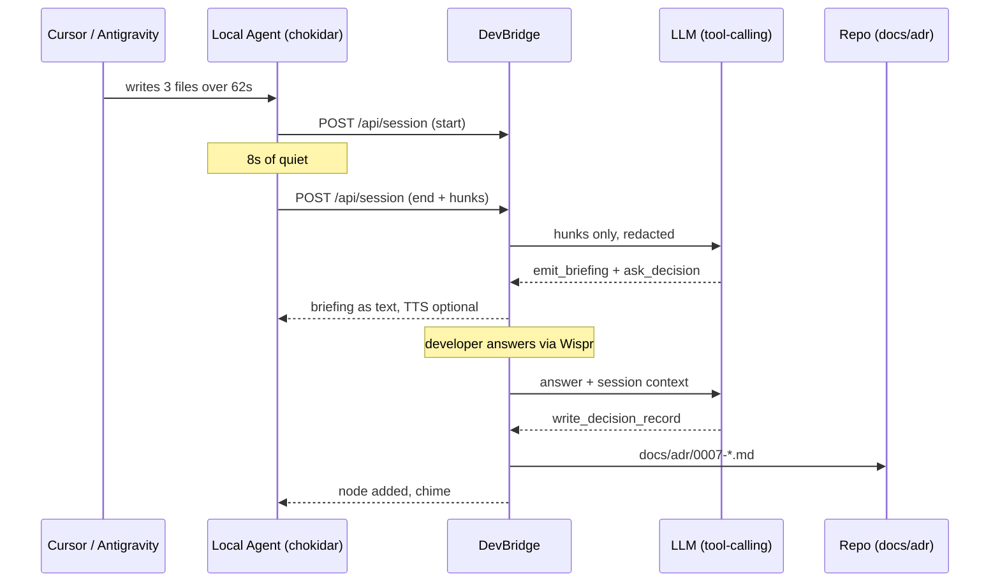

# DevBridge — Product Requirements Document

**Version:** 1.0
**Date:** 25 October 2026
**Owner:** Solo builder, Track 1 (Builders)
**Submission deadline:** 31 October 2026, 23:59 IST
**Status:** Approved for build — supersedes `DEVBRIDGE_EVOLUTION_PLAN.md` and `DevBridge_Print_Ready.pdf`

---

## 0. What this document replaces

Two conflicting specs are currently in circulation. This PRD is the single source of truth.

| Document | Status | Reason |
| :--- | :--- | :--- |
| `DevBridge_Print_Ready.pdf` | **Retired** | Camera-based. TensorFlow phone detection, webcam as feature 2. Contradicts the evolved design and the privacy argument. |
| `DEVBRIDGE_EVOLUTION_PLAN.md` | **Superseded** | Correct instinct (drop the camera), wrong target (brainstorms the *next* step during a build). Kept for history only. |
| `PRD.md` (this file) | **Active** | Defines what gets built, what gets cut, and how each requirement is verified. |

Any future claim in a video, README, or submission form must be traceable to a numbered requirement in §6.

---

## 1. Summary

DevBridge turns the 60–90 second AI build wait into a spoken code review.

When Cursor or Antigravity stops writing files, DevBridge reads what just landed and says — in the developer's own language — what changed and which line is worth worrying about. It asks exactly one question about that line. The developer answers out loud through Wispr Flow. The answer is written into the repository as a decision record that the next AI prompt inherits.

**One line:** *The build wait, spent on the code you just got.*

**What it is not:** a phone detector, a focus timer, a productivity score, or a dashboard of eight features.

---

## 2. The problem, restated

### 2.1 The observable behaviour

A developer prompts an AI coding tool. The tool spends 60–120 seconds planning and writing files. During that window there is nothing for the developer to do, so attention leaves the screen. Sometimes it comes back in ninety seconds. Sometimes it comes back in forty minutes.

### 2.2 Why the previous framing was wrong

The earlier plan treated the phone as the disease and the build wait as the symptom. It is the reverse.

1. **The wait is empty because the developer is not needed.** Filling it with a lecture does not make them needed; it makes them interrupted. A design conversation about the *next* step competes directly with reading the diff of the *last* step — which is the exact skill the target user lacks.
2. **The psychological claim does not hold.** "You cannot scroll while speaking" is false; people scroll during phone calls constantly. The real mechanism is narrower: a question addressed to you creates an obligation to answer. That only works if the question is worth answering, which means it must be grounded in the code that just appeared.
3. **Speaking aloud is socially expensive.** For the target user — Indian developers in offices, coworking spaces, hostels, and libraries — a laptop that talks about Redis TTLs gets muted in week one. A muted DevBridge is a text dashboard with no differentiator.

### 2.3 The corrected problem statement

> Developers using AI coding tools do not review what the AI wrote. The 60–90 second build wait is the only free attention they will get all day, and it currently evaporates. Meanwhile the code merges unread, and the developer cannot explain or defend it later.

### 2.4 Evidence we have, and evidence we need

| Claim | Current evidence | Required before submission |
| :--- | :--- | :--- |
| Build waits are 60–120s | Anecdote | Logged durations from ≥ 5 real sessions (FR-13) |
| Developers leave the screen during waits | Anecdote | Not measured. Do not claim it as a number. |
| "40 minutes lost" | Asserted, never measured | Either instrument it or remove the number from the pitch |
| AI-written code goes unreviewed | Widely reported | Cite one external source in the submission writeup |

**Rule:** no number appears in the demo video that is not in `.devbridge/metrics.jsonl`.

---

## 3. Users

### 3.1 Primary persona — Aarav, 21, final-year student

Builds a SaaS side project with Cursor. Has never written an auth flow by hand. Cannot explain his own token refresh logic in an interview. Works from a shared hostel room, so he cannot talk to his laptop for long stretches. Hindi is the language he thinks in; English is the language his code is in.

**Job to be done:** *When the AI finishes a chunk of code, help me understand what it actually did, so I can defend it tomorrow.*

### 3.2 Secondary persona — Meera, 27, backend engineer

Ships features with Antigravity at a startup. Reviews maybe a tenth of generated code. Has been burned once by a silent regression in a background job. Works in an open office and wears one earbud.

**Job to be done:** *When a build lands, tell me the one thing most likely to bite me in production, and let me decide it now instead of in the incident review.*

### 3.3 Anti-personas

- Teams wanting shared review dashboards — out of scope.
- Developers who want a general chat assistant — Cursor already is one.
- Anyone wanting surveillance of their own habits — explicitly rejected (§4.5).

---

## 4. Product principles

1. **Give the wait a job, not a lecture.** The unit of value is comprehension of what just landed, not speculation about what comes next.
2. **Ask in text, answer by voice.** Wispr is an input device. The machine does not need to speak to be voice-first.
3. **Every decision leaves a trace.** If a decision does not produce a file, it did not happen.
4. **One question beats eight features.** The product has exactly one question in flight at any time.
5. **The repository never leaves the machine.** Only diff hunks travel to the model, redacted. No camera, no screen capture, no telemetry beyond a local log.

---

## 5. The core loop



| Step | Trigger | Budget | Output |
| :--- | :--- | :--- | :--- |
| 1. Detect | ≥ 2 files or ≥ 40 changed lines within 120s, then 8s quiet | — | `BuildSession` |
| 2. Brief | Session closed | < 6s p95 | ≤ 3 sentences, ≤ 25s spoken |
| 3. Ask | Briefing rendered | — | Exactly 1 question, anchored to a hunk |
| 4. Capture | Wispr release or typed submit | — | Transcribed answer |
| 5. Commit | Answer received | < 4s | ADR file + decision log entry |

**Total loop: under 30 seconds of developer attention.** If it takes longer, the developer has already gone back to the diff.

---

## 6. Functional requirements

Every requirement is testable. `MUST` items are submission-blocking.

### 6.1 Detection

**FR-01 (MUST) — Session detection.**
The local agent watches a repo and emits a `BuildSession` when ≥ 2 files change or ≥ 40 lines change within a 120-second window, followed by 8 seconds of no writes.

*Acceptance:* run a scripted 3-file write; a session appears in the app within 10s of the quiet period. Lockfiles, `node_modules`, `.next`, and formatter-only diffs do not open a session.

**FR-02 (MUST) — Manual trigger.**
A keyboard shortcut opens a session from the current uncommitted diff, for editors whose write patterns the watcher misses.

*Acceptance:* with the agent stopped, `⌘⇧B` produces a briefing from `git diff`.

**FR-03 (SHOULD) — Multi-IDE parity.**
Cursor, Antigravity, and Codex produce equivalent sessions. No IDE-specific integration code.

### 6.2 Briefing

**FR-04 (MUST) — Grounded briefing.**
The briefing names what changed and identifies exactly one risk, citing `file:line`.

*Acceptance:* for a diff introducing an unguarded `await` in a loop, the briefing mentions the loop and cites the correct line. Reject any briefing that could have been generated without reading the diff.

**FR-05 (MUST) — Two registers.**
`beginner` register explains in plain language with no unexplained jargon. `pro` register names the trade-off and assumes fluency.

*Acceptance:* the same diff produces materially different copy in each register, and neither contains a term the other register would not use.

**FR-06 (MUST) — Text is primary.**
Every briefing is readable without audio. Audio is an enhancement, never the only channel.

*Acceptance:* with system audio muted, the loop is fully completable.

**FR-07 (MUST) — Language.**
Hindi (`hi`) and Indian English (`en-IN`) at launch. Copy is written natively per language, not machine-translated.

*Acceptance:* Hindi copy contains no English syntax calques; reviewed by a native speaker before recording.

### 6.3 Question

**FR-08 (MUST) — One question, anchored.**
Exactly one question, tied to a specific hunk, answerable in one sentence, with 2–4 suggested answers plus free-form.

*Acceptance:* the question cannot be answered "yes" or "no"; it forces a choice between named alternatives.

**FR-09 (MUST) — No question without a diff.**
If the diff is trivial (whitespace, imports, lockfile), the session is closed silently. Never ask a question to fill space.

*Acceptance:* a formatting-only save produces no session and no notification.

### 6.4 Capture

**FR-10 (MUST) — Voice in, via Wispr.**
A focused input accepts dictation. Auto-submit on speech end after a 1.5s pause.

*Acceptance:* dictate a 12-word answer; it submits without touching the keyboard.

**FR-11 (MUST) — Typed fallback.**
The same input accepts typing. Both paths produce identical downstream behaviour.

*Acceptance:* typed and dictated answers create byte-identical ADR structure.

### 6.5 Persistence — the differentiator

**FR-12 (MUST) — Decision record written to repo.**
On answer, write `docs/adr/NNNN-slug.md` (MADR-lite) and append to `.devbridge/decisions.jsonl`.

*Acceptance:* the file exists after the loop, is valid markdown, numbers correctly against existing ADRs, and survives a page refresh and a server restart.

**FR-13 (MUST) — Session metrics.**
Every session appends `{id, repo, wait_ms, files, lines, decision_captured, register, lang}` to `.devbridge/metrics.jsonl`.

*Acceptance:* after 5 real sessions, the file can produce the numbers quoted in the video.

**FR-14 (SHOULD) — Constraint export.**
A `CONSTRAINTS.md` accumulates one-line rules from accepted decisions, formatted for pasting into a Cursor rules file.

*Acceptance:* the file is valid markdown and each line traces to an ADR number.

### 6.6 Demo and judge path

**FR-15 (MUST) — Demo mode.**
A hosted build runs a scripted 90-second session with no local agent, no API key, and no repo. Clearly labelled "Demo — scripted session".

*Acceptance:* a stranger opens the link, clicks once, and sees a complete loop including a written ADR.

**FR-16 (MUST) — Judge speaks.**
After the scripted session, the judge can hold a key, speak their own answer, and see it become a decision node and a downloadable ADR.

*Acceptance:* works in Chrome and Safari with the built-in microphone, no sign-in, no permissions beyond mic.

**FR-17 (MUST) — Degraded paths.**
Demo works with the LLM unreachable (canned responses) and with audio unavailable (text only).

*Acceptance:* block the LLM host and reload; the demo still completes.

### 6.7 Interface

**FR-18 (MUST) — Session timeline.**
A chronological list of sessions: waiting, briefing, answered, skipped. Skipped is a first-class state, not an error.

**FR-19 (SHOULD) — Decision graph.**
Nodes are decisions, edges are the files they touch. Clicking a node opens the ADR.

**FR-20 (MUST NOT) — No camera, no phone detection.**
No `getUserMedia` video, no COCO-SSD, no TensorFlow. `PhoneWatchdog` is unmounted and its dependencies removed.

*Acceptance:* `npm ls @tensorflow/tfjs` returns empty; no permission prompt on load.

---

## 7. LLM contract

### 7.1 Why tools, and what makes them real

The previous spec listed three "tools" that formatted text and returned JSON with no effect on the world. A judge asking *"what happens with the result of a tool call?"* would get nothing.

Here, one tool has a side effect: `write_decision_record` creates a file in the user's repository. That is the difference between a formatted response and an agent.

### 7.2 Model and budget

- Model: a fast tool-calling model, temperature 0.2.
- Input: hunks only, max 8k tokens. Whole files are never sent.
- Redaction before send: API keys, tokens, connection strings, `.env` values matched by pattern and replaced with `«redacted»`.
- Cost target: < $0.01 per session. Two calls per loop (brief, then record).

### 7.3 Tool definitions

```json
{
  "name": "emit_briefing",
  "description": "Summarise what the AI coding tool just wrote and identify the single most consequential risk in the diff.",
  "parameters": {
    "type": "object",
    "properties": {
      "summary": { "type": "string", "description": "Max 2 sentences. What changed, in the developer's register." },
      "risk": { "type": "string", "description": "One sentence naming the risk and its consequence." },
      "anchor": { "type": "string", "pattern": "^[^:]+:\\d+(-\\d+)?$", "description": "file:line of the risk." },
      "severity": { "type": "string", "enum": ["low", "medium", "high"] },
      "skip_reason": { "type": "string", "description": "Set when the diff is trivial; no question will be asked." }
    },
    "required": ["summary", "severity"]
  }
}
```

```json
{
  "name": "ask_decision",
  "description": "Ask exactly one question that forces an architectural choice about the anchored hunk. Never yes/no.",
  "parameters": {
    "type": "object",
    "properties": {
      "question": { "type": "string", "maxLength": 220 },
      "options": { "type": "array", "minItems": 2, "maxItems": 4, "items": { "type": "string" } },
      "why_now": { "type": "string", "description": "Why this cannot wait until after the build." },
      "anchor": { "type": "string", "pattern": "^[^:]+:\\d+(-\\d+)?$" }
    },
    "required": ["question", "options", "anchor"]
  }
}
```

```json
{
  "name": "write_decision_record",
  "description": "Persist the developer's answer as an ADR file in the repository. Call only after an answer exists.",
  "parameters": {
    "type": "object",
    "properties": {
      "title": { "type": "string", "maxLength": 70 },
      "context": { "type": "string", "description": "2-4 sentences: what in the diff forced this." },
      "decision": { "type": "string", "description": "The choice, in the developer's own words where possible." },
      "consequences": { "type": "array", "minItems": 1, "maxItems": 4, "items": { "type": "string" } },
      "alternatives": { "type": "array", "items": { "type": "string" } },
      "anchors": { "type": "array", "minItems": 1, "items": { "type": "string", "pattern": "^[^:]+:\\d+(-\\d+)?$" } }
    },
    "required": ["title", "context", "decision", "consequences", "anchors"]
  }
}
```

```json
{
  "name": "record_session_metric",
  "description": "Append one line to the local metrics log for this session.",
  "parameters": {
    "type": "object",
    "properties": {
      "session_id": { "type": "string" },
      "wait_ms": { "type": "integer" },
      "decision_captured": { "type": "boolean" }
    },
    "required": ["session_id", "wait_ms", "decision_captured"]
  }
}
```

### 7.4 Failure behaviour

| Failure | Behaviour |
| :--- | :--- |
| Model returns no tool call | Retry once, then fall back to the deterministic template |
| Model unreachable | Deterministic template, session still completes, badge shows "offline mode" |
| Tool args fail schema | One repair attempt with the validation error, then template |
| Diff exceeds 8k tokens | Summarise per-file, cap at 12 hunks, note truncation in the briefing |

**The deterministic template is not a stub.** It is a rule set over the diff (new `await` inside a loop, error path with no handler, secret-shaped string, missing auth check on a new route) that produces a real briefing and a real question. The demo must never depend on a network call succeeding.

---

## 8. Data model

### 8.1 Types

```ts
type BuildSession = {
  id: string;
  repo: string;
  startedAt: number;
  endedAt: number;
  waitMs: number;
  files: string[];
  linesAdded: number;
  linesRemoved: number;
  hunks: Hunk[];
};

type Hunk = {
  file: string;
  startLine: number;
  endLine: number;
  added: string[];
  removed: string[];
  language: string;
};

type Decision = {
  id: string;
  sessionId: string;
  question: string;
  answerText: string;
  answerSource: "wispr" | "typed" | "option";
  adrPath: string;
  createdAt: number;
};
```

### 8.2 ADR format (MADR-lite)

```markdown
# 0007 — Reject expired refresh tokens instead of silently reissuing

- **Status:** accepted
- **Date:** 2026-10-27
- **Session:** 8f2c41a0
- **Anchors:** src/auth/rotate.ts:44-58

## Context
Antigravity added a refresh handler that accepts any structurally valid token,
including one that expired eight hours ago. Nothing in the write path checks `exp`.

## Decision
Expired tokens are rejected with 401 and the client re-authenticates. No silent reissue.

## Consequences
- A background tab wakes up logged out after a long sleep.
- Token families cannot be extended indefinitely by a malicious client.
- `rotate.ts` now needs an explicit expiry test in the auth suite.

## Alternatives considered
- Silent reissue with a short grace window — rejected: hides replay.
- Redis blacklist — deferred: adds infrastructure for a problem we do not have yet.
```

### 8.3 Storage

No database in v1. Filesystem is the store, which is also the product's point.

| Path | Contents |
| :--- | :--- |
| `docs/adr/NNNN-*.md` | Decisions, visible to git, reviewable, inheritable by the next prompt |
| `.devbridge/decisions.jsonl` | Machine-readable log for the graph |
| `.devbridge/metrics.jsonl` | Session metrics for the submission numbers |
| `.devbridge/sessions/` | Raw hunks, 7-day retention, gitignored |

---

## 9. Interface

### 9.1 Screens

| Screen | Purpose | Required states |
| :--- | :--- | :--- |
| Timeline | All sessions, newest first | empty, building, awaiting answer, answered, skipped, offline |
| Briefing card | Summary, risk, anchor | text-only, with audio, truncated |
| Question | One question, options, input | idle, listening, submitting, answered |
| Decision | ADR preview, file path | just-written, existing, copied |
| Graph | Decisions and their files | empty, 1 node, 20+ nodes |
| Demo banner | Honest labelling | demo, live, offline |

### 9.2 The judge path — first 60 seconds

1. **0s** — Page loads. One sentence: *"Your AI just wrote 61 lines. Here is what matters."* A scripted session is already mid-build, visibly writing files.
2. **12s** — Build completes. Briefing appears as text and starts speaking.
3. **30s** — Question appears with three options. One is highlighted as the AI's recommendation, clearly marked as a suggestion.
4. **45s** — Demo answers itself. ADR appears, file path shown, node added to graph.
5. **60s** — *"Now you try. Hold ⌘ and tell me what you would have chosen."* Judge speaks. Their words become node 4 and a downloadable ADR.

No sign-in. No setup. No tour.

### 9.3 Copy deck

**Hindi, beginner register**

> Briefing: अभी Cursor ने लॉगिन राउट में टोकन चेक जोड़ा है — 42 लाइनें, तीन फाइलें। सबसे ज़रूरी बात: टोकन एक्सपायर होने पर भी मान लिया जा रहा है।
>
> Question: अगर टोकन एक्सपायर हो चुका है, तो ऐप क्या करे — यूज़र को फिर से लॉगिन भेजे, या चुपचाप नया टोकन बना दे?

**Indian English, pro register**

> Briefing: Antigravity wrote the refresh handler in `src/auth/rotate.ts` — three hunks, 61 lines. The write path is sound. The read path takes no lock, so two parallel refreshes can orphan a token family.
>
> Question: Two tabs refresh at the same moment. Do you take a Redis lock on the family, or make rotation idempotent with a nonce?

Copy rules: no em-dash-heavy marketing voice, no "revolutionary", no exclamation marks in the product. The voice is a senior colleague who has read the diff and has thirty seconds.

---

## 10. Demo mode

### 10.1 Script

| t | Event | Fallback if it fails |
| :--- | :--- | :--- |
| 0–12s | Three files write, lines counter climbs | Static pre-rendered diff, same visuals |
| 12s | Briefing appears + audio starts | Text-only, badge "audio unavailable" |
| 30s | Question + options | Pre-recorded question |
| 38–45s | Scripted answer submits, ADR writes | Local write to a virtual FS, same UI |
| 60s | Judge handoff prompt | Skip to ADR download |

### 10.2 Audio

Pre-render the scripted Hindi and English lines to static `.mp3` at build time. A hosted Linux server has no `say` and no Apple voices; a pre-rendered file sounds identical everywhere and cannot fail at the wrong moment. Browser `speechSynthesis` is the fallback for live text, never the primary for the script.

The local macOS path (`say -v Lekha` / `-v Rishi`) remains available in the desktop run and is what the video records.

### 10.3 Honesty

The demo banner reads "Demo — scripted session". The video states which segments are scripted. Claiming a live agent where there is none is the fastest way to lose a judge's trust, and the fastest way to be caught.

---

## 11. Non-functional requirements

| Area | Requirement | Verification |
| :--- | :--- | :--- |
| Latency | Briefing < 6s p95 from session close | Timed across 10 sessions |
| Latency | ADR write < 4s from submit | Timed |
| Privacy | No video capture; only redacted hunks leave the machine | Code review + network tab |
| Privacy | No account, no server-side storage of code | Architecture review |
| Cost | < $0.01 per session | Token count × price, logged |
| Compatibility | Chrome, Safari, current versions; 1280×800 and up | Manual |
| Accessibility | Full keyboard path; all audio has a text equivalent; `prefers-reduced-motion` respected | Keyboard-only run |
| Reliability | Demo completes with LLM blocked and audio blocked | FR-17 test |
| Offline | Loop completes with no network, template mode | Airplane mode test |

---

## 12. Success metrics

### 12.1 Submission scorecard (what the judges see)

| Criterion | Target | Evidence |
| :--- | :--- | :--- |
| Working link | Loads, demo completes, judge can speak | URL + FR-15/16 |
| Demo video | ≤ 2:00, unlisted, shows one real loop | Video |
| Real result | ≥ 3 ADR files from ≥ 5 real sessions | Repo + `metrics.jsonl` |
| Wispr usage card | Screenshot from Insights | Image |
| Genuine tool calling | `write_decision_record` creates a file on camera | Video segment |
| Meaningful Wispr use | Every decision in the video is spoken, not typed | Video + usage card |

### 12.2 Product metrics (what tells you if it works)

- **Decision capture rate** — decisions ÷ sessions. Below 30% means the questions are not worth answering.
- **Time to first decision** — should be under 90 seconds on a first run.
- **Skip reasons** — trivial diff vs. bad question. A rising "bad question" share is the leading indicator of churn.
- **ADR reuse** — how often a decision record is referenced by a later prompt. The only metric that proves the loop closed.

---

## 13. Scope

### 13.1 In

| # | Item | Requirement |
| :--- | :--- | :--- |
| 1 | Session detection + manual trigger | FR-01, FR-02 |
| 2 | Grounded briefing, two registers, Hindi + en-IN | FR-04 to FR-07 |
| 3 | One anchored question | FR-08, FR-09 |
| 4 | Voice capture via Wispr + typed fallback | FR-10, FR-11 |
| 5 | ADR writer + decision log | FR-12 |
| 6 | Session metrics | FR-13 |
| 7 | Hosted demo + judge-speaks | FR-15 to FR-17 |
| 8 | Timeline, briefing card, question, ADR preview | FR-18 |

### 13.2 Out

- Camera, phone detection, TensorFlow (FR-20).
- Sprint timer and productivity scoring — not the product.
- Voice task manager and context-switching queue — a different product.
- MCP server — a protocol nobody in the demo will exercise.
- Team dashboards, accounts, sync.
- Full-repo indexing or embeddings.

### 13.3 Stretch, only if every gate is green

- `CONSTRAINTS.md` export (FR-14).
- Decision graph (FR-19).
- A second language pair.
- VS Code extension shell.

---

## 14. Risks

| # | Risk | L | I | Trigger | Response |
| :--- | :--- | :-: | :-: | :--- | :--- |
| R1 | Watcher misses Antigravity's write pattern | M | H | No session in 3 real builds | Manual trigger becomes primary; ship git-poll fallback |
| R2 | LLM latency breaks the 6s budget | M | H | p95 > 8s | Pre-generate demo briefings; cache by diff hash |
| R3 | Hosted Hindi TTS sounds wrong | H | M | Quality check fails | Pre-rendered mp3 only; never live TTS in the demo |
| R4 | Question quality is generic | M | H | Cannot cite a line | Reject any briefing without a valid anchor; template fallback |
| R5 | Deadline slips | M | H | A phase gate misses by a day | Cut real LLM to demo-only, label it, ship the loop |
| R6 | Repo is a mess at submission | M | M | No clean clone runs | Trunk hygiene from day 1 (see SDLC §5) |
| R7 | The premise does not survive a judge's question | L | H | "Why would I talk to my laptop?" | Text-first framing; voice is input, never required |

---

## 15. Delivery

See `SDLC.md`. Six phases, one gate each, calendar in §4 of that document.

---

## 16. Open questions

| # | Question | Owner | Needed by |
| :--- | :--- | :--- | :--- |
| Q1 | Name: "DevBridge" describes the retired framing (a bridge between tools). Candidates: *Anchor*, *Brief*, *Second Opinion*. | Builder | 27 Oct |
| Q2 | Does the product speak at all, or is audio always opt-in? Default opt-in is a stronger demo; default opt-out is a stronger product. | Builder | 26 Oct |
| Q3 | Should skipped sessions be shown or hidden? Shown normalises skipping; hidden inflates the capture rate. | Builder | 27 Oct |
| Q4 | Is `docs/adr/` the right location, or should it be `.devbridge/` to avoid polluting the repo? | Builder | 28 Oct |
| Q5 | Do we claim a productivity number at all, or lead with the artifact? | Builder | 30 Oct |

---

*DevBridge PRD v1.0 · WeMakeDevs × Wispr Flow, No Hands Challenge · Track 1: Builders*
