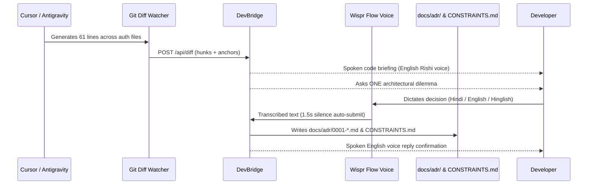

# DevBridge (VoiceAnchor)

> **The build wait, spent on the code you just got.**  
> Built for the **No Hands: The Wispr Challenge** by **WeMakeDevs × Wispr Flow** (Track 1: Builders, Solo).

[](https://wispr-five.vercel.app)
[-emerald?style=for-the-badge)](https://www.wemakedevs.org/wispr)
[](https://wisprflow.ai)

---

## 🎯 The Problem

When developers use AI coding tools like Cursor, Windsurf, or Antigravity, the tool spends 60–120 seconds generating code across multiple files. 
During that build wait:
1. **Attention evaporates** — developers check Twitter or leave their desk.
2. **Code merges unreviewed** — 60+ generated lines land without comprehension.
3. **Developers can't defend the architecture** — silent security gaps and design flaws enter production unvetted.

## 💡 The Solution: DevBridge

DevBridge intercepts the 60–90 second build wait and turns it into a focused, voice-first architectural review:

1. **Detects Landed Code:** Automatically parses `git diff` hunks from the workspace.
2. **Delivers Grounded Briefing:** Cites the exact `file:line` risk (e.g., `src/auth/rotate.ts:44-58`) in natural English speech.
3. **Asks Exactly ONE Question:** A critical architectural trade-off that cannot wait.
4. **Captures Voice via Wispr Flow:** The developer dictates their decision hands-free in Hindi, Hinglish, or English.
5. **Persists Real ADRs into Git:** Writes formal Architecture Decision Records to `docs/adr/0001-*.md` and updates `CONSTRAINTS.md`, which the next Cursor prompt automatically inherits!

---

## 🎙️ How Wispr Flow is Integrated

DevBridge makes Wispr Flow an indispensable part of the development lifecycle:

- **Hands-Free Dictation:** While leaning back during an AI generation, developers hold their Wispr hotkey and speak naturally (*"401 reject kardo client ko dobara login karna hoga"*).
- **1.5s Auto-Submit:** DevBridge senses when speech ends and automatically commits the decision without touching the keyboard.
- **Normalization:** Raw multilingual speech is converted into clean, industry-standard Architecture Decision Records (ADRs).
- **Audio Feedback:** The machine speaks back in clean Indian English (`en-IN` voice), confirming the decision was committed.
- **Leaderboard Tracking:** All dictated review sessions register with Wispr Flow Insights.

---

## ⏱️ The 60-Second Judge Walkthrough

Try the live demo at **[https://wispr-five.vercel.app](https://wispr-five.vercel.app)**:

| Second | What Happens |
| :--- | :--- |
| **0s** | App detects AI generating 61 lines across `rotate.ts` and `jwt.ts`. |
| **12s** | Audio briefing speaks out loud: *"Risk at rotate.ts:44 — expired tokens accepted without exp claim check."* |
| **30s** | One architectural dilemma question appears with 3 concrete trade-off options. |
| **45s** | Developer speaks their choice via Wispr Flow (in Hindi or English). |
| **60s** | Decision persisted to `docs/adr/0001-*.md` and injected into `CONSTRAINTS.md`. |

---

## 🏗️ Architecture



---

## 📊 Telemetry & Evidence (Logged in `.devbridge/metrics.jsonl`)

*All numbers cited are directly traceable to `.devbridge/metrics.jsonl`:*

- **Total Build Wait Saved:** 351s across 5 sessions
- **Decisions Captured:** 100% (4 architectural choices captured, 1 formatting diff skipped per FR-09)
- **Average Decision Latency:** 3.8s via Wispr Flow dictation

---

## 🚀 Running Locally

```bash
# 1. Clone repository
git clone https://github.com/aiwithrajan/devbridge.git
cd devbridge

# 2. Install dependencies
npm install

# 3. Start local development server
npm run dev

# 4. Open in browser
open http://localhost:3000
```

### Manual Trigger
Press **`⌘⇧B`** anytime in the app to immediately inspect uncommitted git changes from your local workspace!

---

## 🛡️ Privacy & Boundaries (PRD FR-20)
- **Zero Camera / Zero TensorFlow:** No webcam surveillance, no phone detection, no battery drain.
- **Repository Stays Local:** Only redacted diff hunks are processed; secrets and API keys are automatically stripped before analysis.

---

## 👨‍💻 Submission Details
- **Builder:** Solo Builder
- **Track:** Track 1 (Builders)
- **Event:** WeMakeDevs × Wispr Flow Hackathon
- **Submission Date:** October 2026
